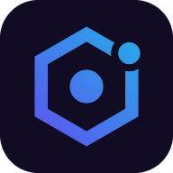

<p align="center"></p>

<h1 align="center">Nano Agent</h1>

<p align="center"><b>A pocket AI agent that does things, not just answers.</b><br>
Its own Linux sandbox, a browser, memory, goals that keep running, and (if you allow it) hands that can use your other apps.</p>

<p align="center">
<a href="https://github.com/deezi74/Nano-agent-/releases/latest">⬇️ Download the latest APK</a> ·
<a href="#use-your-own-key">Use your own key</a> ·
<a href="NOTICE">Credits &amp; license</a>
</p>

---

## What it does

| | |
|---|---|
| 💬 **Chat that acts** | Plans, runs tools, checks its work and stops to ask before anything you could not undo. |
| 🐧 **Linux sandbox** | A real Alpine Linux (PRoot) inside the app: shell, Python, Node, git, file editing. |
| 🌐 **Browser** | Reads and works in web pages for you. |
| ✋ **Hands** *(off by default)* | With Accessibility switched on, it can tap and type in your other apps. |
| 🎯 **Goals & routines** | Tasks that keep working while the app is closed, with notifications. |
| 🧠 **Memory & soul** | Remembers you; its name, voice and personality are yours to set. |
| 🎨 **Pictures, clips, voice** | Image and video models, text-to-speech and voice input from the providers you choose. |
| 🔌 **Connectors** | Notion, GitHub, Slack, Google, Stripe, PayPal and 70+ MCP servers. |

## Install

The APK is built by GitHub Actions on every push and attached to a [release](https://github.com/deezi74/Nano-agent-/releases).

**Android (phone or tablet, arm64)**
1. Open the latest release on the phone and tap `NanoAgent-1.0.N.apk`.
2. Allow *Install unknown apps* for your browser when Android asks.
3. Open Nano Agent and add a model provider (below).

**Install from a computer with ADB (Linux / macOS / Windows / Chromebook Linux)**
```sh
adb install -r NanoAgent-1.0.N.apk
```
On Windows use `adb.exe` from the Android platform-tools; on a Chromebook enable *Linux development environment* and *ADB debugging*, then run the same command in the Linux terminal.

Requires Android 8.0+ on an arm64 (aarch64) device. The Linux sandbox and Hands need arm64; x86 emulators run chat only.

## Use your own key

Nano Agent has no servers of its own. Add any of these under **Settings › Providers**:

- **OpenRouter**: one key, hundreds of models (recommended to start)
- **OpenAI**, **Anthropic Claude**, **Google Gemini**, **xAI Grok**, **Groq**, **Mistral**
- **FreeLLMAPI** or any OpenAI-compatible server: base URL e.g. `http://localhost:3001/v1` (in Termux) and model `auto`
- **Ollama**, **LM Studio**, **vLLM** on your own machine

Then pick a model for each job under **Settings › Models**: *Chat*, *Operating the screen* (needs a vision model), *Making pictures*, *Making clips*.

## Build it yourself

GitHub Actions does this for you ([workflow](.github/workflows/android.yml)). Locally (Linux x86_64 or macOS; Windows via WSL2; Chromebook via Crostini):

```sh
git clone --recurse-submodules https://github.com/deezi74/Nano-agent-.git
cd Nano-agent-
# JDK 21, Android SDK (platform 36, build-tools 35, cmake 3.22.1, NDK 27.2.12479018), Go 1.26
export ANDROID_HOME=$HOME/Android/Sdk ANDROID_NDK_HOME=$ANDROID_HOME/ndk/27.2.12479018
bash scripts/android/build-natives.sh          # proot, Alpine rootfs, rclone.aar
cd android/src/android && ./gradlew :app:assembleRelease
```

Building on the phone itself (Termux) is not supported: the build needs the full Android SDK and NDK.

### Updating from nanoMuse

Nano Agent tracks nanoMuse. To take a newer nanoMuse: copy its `android/` over this one (keeping `android/deps/proot`), then run

```sh
python3 scripts/brand.py      # name, app id, English / US defaults, links, colours
python3 scripts/gen-icons.py  # icons
python3 scripts/tint-avatar.py  # default agent colour (only on fresh upstream images)
```

### Signing

Without setup, CI makes one signing key and keeps it in the Actions cache. For a permanent key add these repository secrets: `NA_KEYSTORE_B64` (base64 of a `.jks`), `NA_KEYSTORE_PASSWORD`, `NA_KEY_ALIAS`, `NA_KEY_PASSWORD`.

## Privacy

Everything stays on the phone except what you send to the model provider you chose. See [PRIVACY.md](PRIVACY.md).

## Credits & license

Nano Agent is free software under the **GNU GPL v3 or later** ([LICENSE](LICENSE)). It is built on
[nanoMuse](https://github.com/nano-muse/nanoMuse) by the nanoMuse contributors, which is in turn
based on [OpenMinis](https://github.com/OpenMinis/OpenMinis) 1.13. Third-party components are listed in
[THIRD_PARTY_NOTICES.md](THIRD_PARTY_NOTICES.md) and `android/THIRD_PARTY_LICENSES.md`.
Nano Agent is not affiliated with nanoMuse, OpenMinis or Meta. See [NOTICE](NOTICE).
